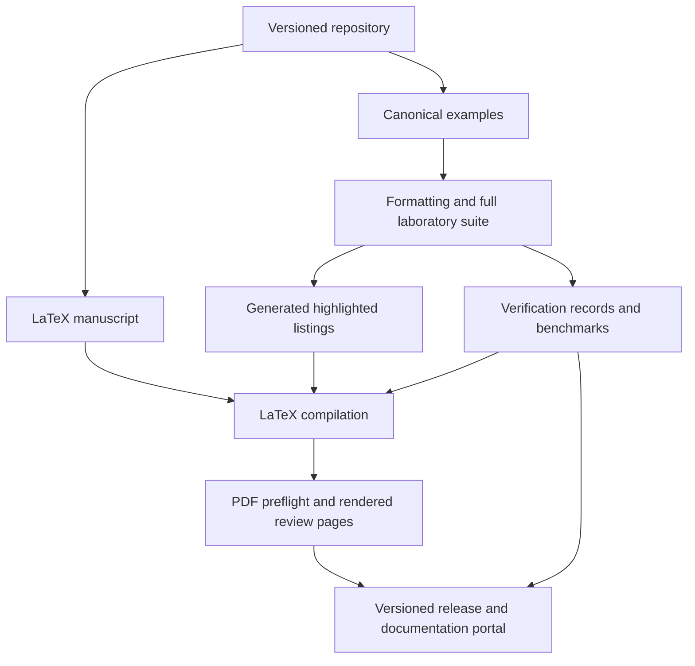

# Modern Perl Concurrency

*Synchronization, Distributed Coordination and Application Architecture*

**An illustrated engineering handbook and executable laboratory for Perl developers.**

[](https://github.com/interrupt21h/Modern-Perl-Concurrency/releases/latest)
[](https://github.com/interrupt21h/Modern-Perl-Concurrency/actions/workflows/tidy-handbook.yml)

[Documentation website](https://interrupt21h.github.io/Modern-Perl-Concurrency/) · [Read the full handbook online](https://interrupt21h.github.io/Modern-Perl-Concurrency/book/) · [Latest release](https://github.com/interrupt21h/Modern-Perl-Concurrency/releases/latest) · [Source examples](examples/) · [Build history](https://github.com/interrupt21h/Modern-Perl-Concurrency/actions)

## Read and download

| Publication | Description | Download |
| :--- | :--- | :--- |
| **Engineering handbook** | In-depth explanations, illustrated strategy cards, architecture diagrams and syntax-highlighted examples. | [HTML chapters](https://interrupt21h.github.io/Modern-Perl-Concurrency/book/) · [PDF](https://github.com/interrupt21h/Modern-Perl-Concurrency/releases/latest/download/modern-perl-concurrency.pdf) |
| **Illustrated cheat sheet** | Two landscape US Letter pages with 24 reference diagrams. Designed for double-sided printing. | [PDF](https://github.com/interrupt21h/Modern-Perl-Concurrency/releases/latest/download/perl-concurrency-cheat-sheet.pdf) · [LaTeX](cheat-sheet.tex) |
| **Source and laboratory** | Complete LaTeX project, executable examples, diagrams and build tooling. | [Source archive](https://github.com/interrupt21h/Modern-Perl-Concurrency/releases/latest/download/formatted-source.tar.gz) |
| **Build verification** | Formatter output, regression results, compilation log and download integrity. | [Build log](https://github.com/interrupt21h/Modern-Perl-Concurrency/releases/latest/download/tidy-build.txt) · [SHA-256](https://github.com/interrupt21h/Modern-Perl-Concurrency/releases/latest/download/SHA256SUMS) |

For the cheat sheet, print at actual size (100%), in landscape orientation, flipping on the short edge for double-sided use.

The stable edition is [v2.1.1](https://github.com/interrupt21h/Modern-Perl-Concurrency/releases/tag/v2.1.1) once its publication gate succeeds. Subsequent automated releases remain separately versioned. The current release includes `verification.json` and `benchmark-results.txt`, with the actual environment and observed timings.

## About the guide

Concurrency is not simply a choice of lock. This guide explains how to select the appropriate execution model, protect shared state, handle contention and recover from failures.

Designed for junior developers learning synchronization and experienced engineers maintaining production Perl applications, it combines plain-language explanations, technical diagrams, runnable examples and engineering trade-offs.

| Area | Topics |
| :--- | :--- |
| **Execution models** | Interpreter threads, forked processes, worker pools, MCE, event loops and asynchronous I/O |
| **Synchronization** | Mutexes, semaphores, condition variables, queues, barriers, reader/writer locks and native futexes |
| **Process coordination** | File locks, System V IPC, pipes, ownership and crash recovery |
| **Database transactions** | MySQL/InnoDB, DBI, DBIx::Class, pessimistic and optimistic locking, advisory locks and job claims |
| **Distributed coordination** | Redis/Valkey leases, atomic scripts, optimistic transactions, fencing, semaphores and Streams |
| **Application architecture** | Moose and Catalyst object lifetimes, service-layer transactions, resumable batch processing, reliable integrations, migration and concurrency testing |
| **Web applications and caches** | Catalyst sessions, API credentials, idempotency, rate limiting and Memcached CAS |

## Continuously verified technical publishing

Modern Perl Concurrency is a continuously verified technical reference that combines professional LaTeX typesetting, executable examples, automated testing and repeatable publication through GitHub Actions (continuous integration, or CI). The book and its supporting software are maintained as a unified engineering project.

Rather than treating the PDF as a manually assembled manuscript, the project treats it as a versioned release artifact. Canonical example sources feed both the executable laboratory and the generated syntax-highlighted listings. The publication pipeline exercises concurrency invariants against disposable services, records benchmark observations and checks the compiled documents before release.



This approach is particularly useful for concurrency: examples can appear correct while hiding races, deadlocks or failures under contention. Automated invariant checks and deliberately reproduced failure scenarios provide inspectable evidence, not a formal proof of correctness or a substitute for independent review.

Each successful publication includes a source snapshot, verification manifest, benchmark results, build log and checksums. The [workflow source](.github/workflows/tidy-handbook.yml) and [build history](https://github.com/interrupt21h/Modern-Perl-Concurrency/actions) expose the process to readers. The architecture is also intended as a reusable model for technical publishing beyond Perl.

## Reading map

| Part | Focus |
| :--- | :--- |
| I | Foundations and mental models |
| II | Perl and operating-system synchronization |
| III | Database concurrency and application transactions |
| IV | Distributed coordination |
| V | Application architecture and the data-processing capstone |
| VI | Production engineering |
| Appendices | Native implementation, API security, laboratories, example catalog, glossary, references and subject/API index |

## Using this repository

[Build the documents](#build-the-documents) · [Run the laboratory](#run-the-laboratory) · [Catalyst application](#catalyst-laboratory) · [Source organization](#project-layout) · [Formatting and publication](#formatting-and-publication)

## Build the documents

```bash
python3 -m venv .venv
. .venv/bin/activate
python -m pip install -r requirements-docs.txt
make
```

Requires Python 3, GNU Make, latexmk and TeX Live (pdfLaTeX, fvextra, upquote,
TikZ, tcolorbox, titlesec, caption, enumitem, needspace, adjustbox, xurl and
Latin Modern). On Debian/Ubuntu, `texlive-latex-extra`, `texlive-pictures`,
`texlive-fonts-recommended`, `lmodern` and `latexmk` provide the TeX packages.
The output is `guide.pdf`. `make clean` removes the handbook's LaTeX intermediates.

Build the standalone cheat sheet separately:

```bash
latexmk -pdf -interaction=nonstopmode -halt-on-error -file-line-error cheat-sheet.tex
```

The output is `cheat-sheet.pdf`.

For a TeX-only build of this exact source snapshot, the pre-generated
highlighted listings are included:

```sh
latexmk -pdf -interaction=nonstopmode -halt-on-error -file-line-error guide.tex
```

After editing any listing source, use `make` (or `python3 scripts/highlight.py`
before running latexmk). The highlighting script checks that tokenization
preserves the full source text. No LaTeX shell escape is required.

## Run the laboratory

The guide contains complete executable examples alongside excerpts, commands,
configuration and transcripts. Every executable example checks its own invariant and exits non-zero on violation.
The test harness runs local examples and enables service-backed examples when their endpoints are configured. Optional modules may cause tests to be skipped.

> [!WARNING]
> Run the laboratory only against isolated, disposable services. Examples modify and delete keys and tables. See [Laboratory safety](#laboratory-safety).

```bash
# Local only (threaded Perl, System V IPC):
./run-tests.sh

# Full suite against DISPOSABLE services:
mysql -u lab -p concurrency_lab < examples/schema.sql
export DB_DSN='DBI:mysql:database=concurrency_lab;host=127.0.0.1'
export DB_USER=lab DB_PASS=...            # inject via your secret mechanism
export REDIS_SERVER=127.0.0.1:6379 MEMCACHED_SERVER=127.0.0.1:11211
./run-tests.sh
```

Optional for Redis ACL testing: `REDIS_USERNAME` and `REDIS_PASSWORD`
(examples 13, 16 and 31 honor them; see the guide's ACL section).

CPAN dependencies by example group:

| Examples | Modules |
|---|---|
| 01–09, 20, 22, 23, 25, 26 | core only (threaded Perl) |
| 21 | C compiler (C11, pthreads; compiled into a scratch dir by run-tests.sh) |
| 24 | Perl 5.36+ (try/catch, defer) |
| 27 | MCE |
| 28 | Catalyst, Catalyst::Plugin::Session, Session::State::Cookie, Sereal, Starman, Redis (Debian/Ubuntu: libcatalyst-perl, libcatalyst-plugin-session-perl, libcatalyst-plugin-session-state-cookie-perl, libsereal-perl, starman) |
| 30 | as 28, plus Crypt::JWT and YAML::XS (libcrypt-jwt-perl, libyaml-libyaml-perl) |
| 10–12, 18 | DBI, DBD::mysql (or DBD::MariaDB with a DSN change) |
| 29 | DBIx::Class, DBI, DBD::mysql |
| 13, 16–18, 31 | Redis (Redis::Fast is API-compatible) |
| 14 | Cache::Memcached::Fast |
| 19 | Future::AsyncAwait, IO::Async |

Example 15 is a protocol transcript, not a script. Redis examples need Redis
6.2+ or Valkey 7.2+ (example 17 uses XAUTOCLAIM). The schema needs MySQL
8.0.16+ for enforced CHECK constraints and expression defaults.

Example 18 depends on the Redis fence counter staying ahead of the database.
If you flush or restart Redis without persistence, reload `schema.sql` before
rerunning it. Otherwise it reports that fencing failed safe, which is the
behavior it is meant to demonstrate.

## Application architecture laboratories

Examples 32–39 use synthetic data and disposable local resources. Install `libmoose-perl`, `libdbix-class-perl`, and `libdbd-sqlite3-perl` on Debian/Ubuntu to enable the new optional tests. SQLite examples verify transaction and replay contracts, not MySQL locking semantics.

| Example | Invariant |
| --- | --- |
| 32 | Forked worker owns its own Moose resource |
| 33 | Layered DBIx::Class operation rolls back as a unit |
| 34 | Replay after ambiguous delivery produces one durable effect |
| 35 | Deterministic lost update reproduced and corrected |

## Processing capstone

The capstone in `examples/36-processing-capstone.pl` uses disposable SQLite databases and bounded work admission. It exercises worker termination, reclaim, replay, conditional completion and duplicate-safe delivery. Examples 37–39 cover savepoints, cancellation and benchmark trials. See Part V and the laboratory appendix.

## Catalyst laboratory

`examples/catalyst-session/` is a complete Catalyst application (hardened
Redis session store, session lock, idempotency keys, rate limiting, logout
everywhere). `examples/28-catalyst-sessions.pl` starts it under Starman with
four workers on a free loopback port and verifies 29 properties.

The same application exposes an API (`SessionLab::Controller::API`,
`SessionLab::Tokens`) described by `examples/catalyst-session/openapi.yaml`
(OpenAPI 3.2.0): hashed API keys with per-key rate limits, JWT access tokens
(algorithm pinned, `exp` and `typ: at+jwt` required, jti denylist), refresh-token
rotation with reuse detection that is safe under concurrent refreshes, and
HMAC-signed requests with single-use nonces. `examples/30-api-tokens.pl`
verifies 33 properties, including the naive rotation race it fixes. Set
`SESSIONLAB_JWT_KEY`, `SESSIONLAB_REFRESH_KEY` and `SESSIONLAB_SIGNING_KEY`
outside the laboratory; the built-in defaults are public.

To explore it by hand:

```bash
REDIS_SERVER=127.0.0.1:6379 starman --workers 4 --listen 127.0.0.1:5000 \
    examples/catalyst-session/app.psgi
```

## Memcached Catalyst laboratory

Example 40 runs a second Catalyst application under four Starman workers with Memcached and MySQL. It serves its [OpenAPI 3.1 application programming interface (API) contract](examples/catalyst-memcached/openapi.json) at `/openapi.json`, uses database-backed opaque bearer credentials with read/write scopes, and exercises compare-and-swap (CAS) counters, advisory rate limiting, durable idempotency and revocation. Concurrent HTTP tests verify that deleting cache entries does not duplicate the durable order.

Run `perl examples/40-catalyst-memcached.pl` with the disposable database and Memcached environment described above. The driver provisions temporary credentials and cleans up its database rows. This is a loopback laboratory, not a production authentication service.

## Laboratory safety

The examples create, delete and flush keys and tables in the namespaces they
use (`lease:*`, `fence:*`, `sem:*`, `jobs:{demo}`, the session lab's `sess:*`,
`cart:*`, `idem:*`, `charges:*`, `ratelimit:*`, `user-sessions:*`, `slock:*`, and
the lab schema). Run them
only against isolated, disposable services. The reader/writer lock and barrier
are educational implementations. Cache leases must never be the sole
authority for correctness-critical operations.

## Project layout

- `guide.tex`: main handbook and shared document macros.
- `chapters/`: application architecture, pipelines, integration, capstone, deployment and reference catalog.
- `cheat-sheet.tex`: standalone, two-page illustrated quick reference.
- `distributed-cache.tex`, `catalyst-sessions.tex`, `api-credentials.tex`:
  chapter/section source files.
- `styles/code-layout.tex`: shared, page-breakable code box style.
- `styles/quick-reference-diagrams.tex`: canonical 24 diagrams reused by the handbook and cheat sheet.
- [Review status](REVIEW-STATUS.md): source audit and remaining work.
- `examples/`: original executable programs, schema, protocol transcript and
  Catalyst lab application; edit these, not the highlighted output.
- `snippets/`: original inline excerpts extracted verbatim into separate files.
- `figures/`: TikZ figure sources.
- `generated/code/`: generated TeX token streams and palette; do not edit by hand.
- `scripts/highlight.py`: language-aware highlighting and source-preservation check.
- `scripts/build-chapters.py`: full chapter-by-chapter HTML reader from the verified PDF, with vector pages, selectable text, cross-page links and a text reading mode.

The code listings use Perl, C, SQL, Shell, Lua, YAML and plain-text output
lexers. Long listings repeat their title on continuation pages; wrapping does
not change the underlying source file. The source files are authoritative for
copying and running examples.

### Source style and execution boundary

Perl is the application language. Redis Lua is embedded server-side code; it
has its own syntax highlighting, with a separate header for standalone scripts.
Example 31 uses WATCH/MULTI/EXEC instead of Lua for owner-checked renewal and
release. Use four-space indentation and prefer one statement per line. Keep
heredoc delimiters and script contents intact when formatting Perl. The source
files are the canonical examples; extracted excerpts are explicitly labelled.

## Formatting and publication

Install Perl::Tidy (the reference formatter release is
20260826 from CPAN). On Debian/Ubuntu:

```bash
sudo apt-get install cpanminus
sudo cpanm SHANCOCK/Perl-Tidy-20260826.tar.gz
```

The distribution's `perltidy` package is also suitable if its version supports
all options in `.perltidyrc`. With the documentation dependencies installed:

```bash
make tidy          # format .pl, .pm, .psgi and .t under examples/ and snippets/
make tidy-check    # verify formatting without modifying source
make tidy-rebuild  # format, check, run local regression suite, regenerate PDF
```

The formatting driver stages results for the Perl source files in memory before
writing any changes, rejects formatter diagnostics and non-idempotent output,
and checks embedded Lua bodies byte-for-byte. The formatter targets 76 columns;
long literals or embedded scripts may still require PDF line wrapping. The
standalone Lua, C, SQL and other non-Perl files are intentionally untouched.
Review the source diff and run integration tests against disposable services
before publication. No formatter can prove semantic equivalence by itself.

The [Build, test and publish handbook](.github/workflows/tidy-handbook.yml) workflow runs on updates to `main` and manual dispatch. Successful builds persist validated formatting, create a versioned release containing the handbook and cheat sheet PDFs, and deploy the documentation portal. CI artifacts include build logs, source differences and the complete HTML reader. The HTML reader is generated before release from the same PDF, with chapter boundaries taken from Hyperref bookmarks, exact page coverage checked, and commit/tag/PDF SHA-256 recorded in `book/manifest.json`. The illustrated reading mode retains all diagrams and code formatting; the reflowable text mode is a PDF-derived transcript, not a semantic LaTeX conversion. Canonical source files remain the authority for runnable code.

To render a local HTML reader after `make pdf`:

```sh
python3 scripts/build-chapters.py guide.pdf site-dist/book \
  --commit "$(git rev-parse HEAD)" --tag local
cp guide.pdf site-dist/modern-perl-concurrency.pdf
python3 -m http.server --directory site-dist 8000
```

Open `http://localhost:8000/book/`. The full portal is assembled in CI.

## Verification and revision history

- [Latest release](https://github.com/interrupt21h/Modern-Perl-Concurrency/releases/latest) — current published documents and build verification log.
- [Changelog](CHANGELOG.md) — technical revisions and documentation improvements.
- [Original laboratory verification](test-results.txt) — historical test evidence, not a replacement for current CI results.

A successful build confirms the stages that ran; consult its log for skipped optional and service-dependent tests.

---

## Author

**Scott Muller**  
Software Engineer, Matsch Systems  
Owner & Independent Consultant, 21h Systems  
[scott@21h.io](mailto:scott@21h.io)

*This work is an independent technical publication. The views and recommendations expressed herein are solely those of the author and do not necessarily reflect those of his employer or affiliated organizations. Professional affiliations do not imply institutional endorsement.*

© 2026 Scott Muller.

### Release verification

The publishing workflow provisions disposable MySQL, Redis, Valkey and Memcached services and installs the full module set. `REQUIRE_FULL_SUITE=1` makes skipped laboratories fatal. Full-page rendered review artifacts are available from CI. PDF preflight checks final LaTeX references, overflow and extracted word bounds; visual inspection remains a separate editorial task.

## Licensing

Author-owned prose, diagrams and publications are licensed under [CC BY 4.0](https://creativecommons.org/licenses/by/4.0/). Author-owned example code, snippets and build tooling are licensed under the [MIT License](LICENSE-CODE). Third-party material retains its own terms. See [LICENSE.md](LICENSE.md).
